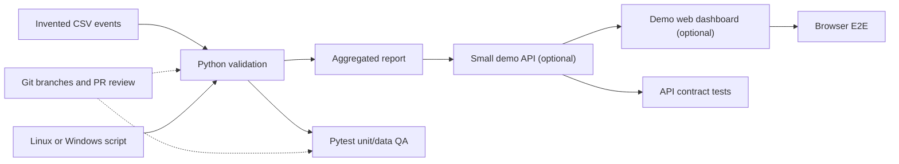

# Cross-Track Capstone: A Fictional Reporting Service

**Goal:** learn how Git, Linux, Python, QA, API testing and web presentation form one coherent engineering workflow. This is a **learning specification**, not an existing deployed system or copy of private working software.

## End-to-end picture

Every box marked **optional** is a possible extension, **not a claim of working implementation**.

## The same task across five disciplines

| Track | Deliverable | Quality evidence |
|---|---|---|
| [Git / GitHub](https://github.com/KonstantinOreshnikov/git-instruction-workshop) | Small reviewed commits and a PR | Diff, staged-file review, no secrets |
| [Python](https://github.com/KonstantinOreshnikov/python-lessons-geekbrains) | Validate fictional CSV and produce grouped summary | Source/output reconciliation and error tests |
| [Linux](https://github.com/KonstantinOreshnikov/linux-testing-python) | Bash launcher; compare with Windows BAT | Exit code, idempotency, logs |
| [QA](https://github.com/KonstantinOreshnikov/web-testing-page-object) | Risk-based test matrix and fixtures | Separate unit, API and browser results |
| API & web (optional) | Fictional endpoint and read-only dashboard | Contract checks and filter correctness |

## Minimal dataset contract

Invent `record_id, period, segment, value`. Declare **one row per record and period**. Reject duplicates and invalid periods. Compare `sum(value)` before/after grouping. For completion shares, declare a separate eligible base and compute the rate **after** filtering, never as an average of precomputed group percentages.

## Five practical milestones

1. Clone a public teaching repository and create a feature branch.
2. Run a synthetic Python parser on Windows and Linux; make error cases explicit.
3. Compare an output report against a hand-calculated control total.
4. Add tests for empty input, duplicates, unexpected columns, zero denominators and no-data filters.
5. Review the PR and explain what was **tested**, what is only a **design**, and what remains **blocked**.

## How it can grow

- Excel or PowerPoint generation using fictional charts.
- A read-only test API with documented status/error contracts.
- Playwright E2E against a locally running demo site.
- GitHub Actions only when the runner and sample fixtures are safe.
- Documentation release with readable Mermaid architecture and QA evidence.

Avoid creating infrastructure merely to claim that every tool was used. The smallest reproducible demonstration with clear acceptance criteria is better than a large unverified architecture.

## Safety boundary

No private course text, personal data, internal SQL, real system credentials, screenshots of private dashboards or proprietary thresholds. Existing legacy repository contents are preserved for historical context but **must be separately reviewed before being represented as security-cleared material**.

**RU · Кратко:** связанный учебный проект от Git и Linux до Python, API, web testing, отчётов и презентаций. Все значения вымышлены; каждый этап имеет собственный QA и честный статус.

Official references: [GitHub Flow](https://docs.github.com/en/get-started/using-github/github-flow), [Python](https://docs.python.org/3/), [pytest](https://docs.pytest.org/en/stable/), [Playwright](https://playwright.dev/docs/intro).
